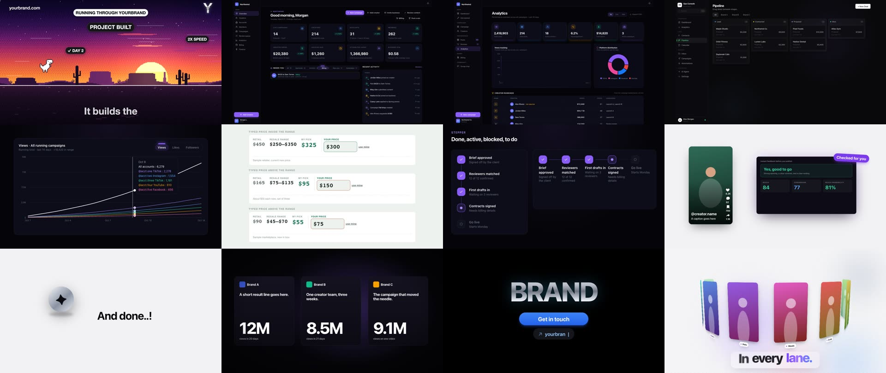

# motion-reel-kit

Make motion-graphics videos with Claude Code: Instagram Reels, TikToks, YouTube Shorts, X videos and long-form brand films, from a one-line prompt or a fully specified brief. White-label: put your brand in one file and every scene, logo, end card and template follows.



Example output: [`docs/media/example-reel.mp4`](docs/media/example-reel.mp4), a 70-second 9:16 pictogram reel made end to end by the kit (local voice, beats pinned to the words, 277 synthesised sound effects, App Store end card), still on the placeholder brand.

## What is inside

| Part | What you get |
|---|---|
| **14 Claude Code skills** | A to Z reel making, viral-format recreation, the animation library, local voiceover, sound design, brand setup, short-form writing rules, transcription, ffmpeg recipes, AI image and video, UGC formats, video breakdowns, cloud voice |
| **5 slash commands** | `/reel`, `/recreate`, `/motion`, `/voice`, `/rebrand` |
| **Animation library** | 229 pieces: 122 motion graphics, 46 UI components, 41 dashboards, 20 sound recipes. Each is a runnable `demo.html` where every frame is `render(t)`, plus a guide with the exact numbers, timings and colours |
| **Pictogram reel pipeline** | A code-drawn, 20-beat faceless parable reel with beats pinned to the voiceover, synthesised sound effects and an App Store end card |
| **Local voice pipeline** | Fast, natural voiceovers on Apple Silicon (Qwen3-TTS, Kokoro) at a set pace and pitch, line-by-line recording, voice design from a description |
| **Reference analysis** | Measure any video you want to copy: cuts, words per minute, pauses, voice pitch, and the clicks, swishes, hits and music bed under the voice |
| **Palettes** | 9 named signature looks (including `arizona-sunset`) and the colours of every library piece |
| **Formats and prompts** | 24 video formats written up beat by beat with what went wrong and how it was fixed, and a short and a detailed prompt for 23 of them |

## Install

You need [Claude Code](https://claude.com/claude-code), Node 18+, Python 3.9+ and ffmpeg. Google Chrome is used for rendering (or set `BROWSER_CHANNEL=chromium` after `npx playwright install chromium`).

**As a plugin** (skills and commands load in every project). Replace `<owner>` with the GitHub account that hosts this repository:
```
/plugin marketplace add <owner>/motion-reel-kit
/plugin install motion-reel-kit@motion-reel-kit
```

**Or clone it** and open Claude Code inside the folder:
```bash
git clone https://github.com/<owner>/motion-reel-kit.git
cd motion-reel-kit
cd engine && npm install && cd ..
pip install -r requirements.txt && playwright install chromium
claude
```

Optional, for free local voices on a Mac with Apple Silicon (about 5 GB of models):
```bash
bash pipelines/voice/setup.sh
```

## Make it yours (two minutes)

1. Edit `brand.config.json`: name, domain, handle, colours, and your App Store listing details and icon.
2. Run:
```bash
python3 engine/tools/apply_brand.py
python3 engine/tools/build_index.py
```
Every `YourBrand`, `yourbrand.com` and `@yourbrand` in the library and pipelines becomes yours. A liquid-chrome monogram and wordmark are rendered from your name, and the pictogram reel's App Store card takes your listing. Run it again any time you change the config. In Claude Code you can just type `/rebrand` instead.

## Use it

Simple:
```
/reel a 40 second reel about why most side projects never launch, ending on our app
```
```
/recreate reference/viral.mp4 same format, about our product
```
```
/motion dino sunset, our colours, 30 seconds
```

Detailed:
```
Make a 60 s 9:16 reel at 30 fps. Hook in 2 s with no brand name. Script below, one line per beat.
Voice m_smooth at 5.0 syllables a second, recorded line by line. Pin every beat to the voice's word times.
Look: arizona-sunset palette, pixel style, type inside x 70-1010 / y 250-1480. Sound: click on every tag,
swish on every cut, a thud on the slam words, a boom on the end card. End card: our App Store listing.
Deliver tall and wide, a contact sheet, and the numbers you measured.
```

More in [`prompts/PROMPTS.md`](prompts/PROMPTS.md): a short and a detailed prompt for 23 of the 24 formats in [`docs/FORMATS.md`](docs/FORMATS.md).

## How the videos are made

Every scene is a web page whose whole picture is a pure function of time, `render(t)`. A headless browser steps through it frame by frame and ffmpeg encodes the frames with the audio. That makes renders exact and repeatable, lets one scene compose at 1080x1920 and 1920x1080, and lets beats be pinned to the voiceover's word times instead of guessed.

```
idea or reference ─▶ script ─▶ voiceover ─▶ word times ─▶ beats pinned to words ─▶ frames ─▶ sound on logged events ─▶ mix ─▶ MP4
```

Try one now:
```bash
open library/LIBRARY.html                                   # browse all 229 pieces, live
node engine/tools/render_demo.cjs video \
  library/motion-graphics/dino-runner-arizona-sunset__pixel-dithered-sky-mesa-parallax/code/demo.html \
  out/dino.mp4 1080 1920
```

### Pictogram reel quick start

The black-and-white parable reel in `pipelines/pictogram-reel` needs a Python with Playwright (`pip install -r requirements.txt && playwright install chromium`):
```bash
cd pipelines/pictogram-reel
python3 build/render.py none stills/ --stills 2,50,69        # look at three frames, no audio needed
../voice/.venv/bin/python ../voice/reel_vo.py m_smooth script.txt vo/voiceover.wav --f0 130-165
python3 tools/make_cues.py vo/voiceover.wav cues.map build/cues.js
python3 build/events.py build/events.json
python3 build/sfx.py build/events.json vo/voiceover.wav vo/mix.wav
python3 build/render.py vo/mix.wav out.mp4
```

## Repository map

```
.claude-plugin/        plugin.json and marketplace.json (installable plugin)
brand.config.json      your brand: the only file you have to edit
commands/              /reel /recreate /motion /voice /rebrand
skills/                the 14 skills Claude loads
library/               229 animation, UI, dashboard and sound pieces; LIBRARY.html, INDEX.md, catalog.json
engine/                render, find, verify, poster, index, rebrand and chrome-logo tools; the demo template and spec
pipelines/
  pictogram-reel/      the code-drawn reel renderer, example script, cues, sound effects
  voice/               local TTS: voice.py, reel_vo.py, design.py, pitch check, setup
  reference-analysis/  measure a reference video
palettes/              PALETTES.md, palettes.json, index.html swatches
docs/FORMATS.md        24 formats, beat by beat, with lessons
prompts/PROMPTS.md     ready-to-paste prompts
```

## Skills

| Skill | Use it for |
|---|---|
| `reel-maker` | The whole job, idea to exported file |
| `recreate-viral-format` | "Make one like this": measure a reference and map a new story onto its beats |
| `motion-library` | Find and adapt a scene, transition, UI animation, dashboard or sound |
| `pictogram-reel` | The black-and-white faceless parable format |
| `short-form-principles` | Hooks, scripts and honesty rules |
| `voiceover-local` | Free local narration with set pace and pitch |
| `voiceover-elevenlabs` | Cloud narration with your own key |
| `sound-design` | Clicks, swishes, thuds, booms, beds and the final mix |
| `brand-setup` | White-label everything, apply palettes |
| `transcribe` | Word timestamps with faster-whisper |
| `media-processing` | ffmpeg recipes: crop, captions, loudness, export |
| `video-breakdown` | Why a video worked, as a reusable recipe |
| `ugc-video-playbook` | Creator-style formats and scripts |
| `ai-image-video` | Generated images and footage, local first, your own keys |

## Adding your own pieces

Follow [`engine/SKILL-SPEC.md`](engine/SKILL-SPEC.md), then:
```bash
node engine/tools/make_posters.cjs <slug>
python3 engine/tools/build_index.py
node engine/tools/verify_library.cjs <slug>      # runs the demo and checks every frame is a pure function of time
```

## Keys and privacy

The render tools start Chrome with `--allow-file-access-from-files` so a demo can load its own fonts and scripts from disk. They only ever open the kit's local demo files.


Nothing in the kit calls a paid service unless you ask for it. Cloud tools read keys from environment variables (`ELEVENLABS_API_KEY`, `FAL_KEY` and similar) and never from files. Reference videos, recordings and renders go in git-ignored folders (`reference/`, `out/`, `vo/`). See `.gitignore`.

## Troubleshooting

- **Render says Chrome is missing:** install Google Chrome, or `npx playwright install chromium` and `export BROWSER_CHANNEL=chromium`.
- **Fonts look different from the posters:** some pieces use the system display font (SF Pro on Apple devices). Other systems fall back to Helvetica or Arial.
- **The voice sounds childlike or slow:** measure it with `python3 pipelines/voice/tools/f0.py out.wav`; see `skills/voiceover-local`.
- **A piece still says YourBrand:** run `python3 engine/tools/apply_brand.py` after editing `brand.config.json`.

## Licence

MIT for the kit's own code and docs. Bundled fonts and three.js keep their own licences: see [`THIRD_PARTY_NOTICES.md`](THIRD_PARTY_NOTICES.md). Use your own brand assets and real facts on end cards.
